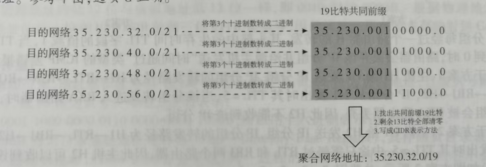

## PV大题做题思路及坑点注意

1、注意共享资源要加互斥变量

2、自己定义的信号量若有多个进程会同时需要访问，也要加互斥变量

3、检查自己的信号量有没有多余，可以某个资源是被某个进程独享的

4、注意一个读写原则，多个读进程可以不互斥，但写进程一定要与读进程互斥

##  (三) 数据链路层 → 3. 流量控制与可靠传输机制*坑点*

* 对于GBN分组确认时，一定要注意是按序接收的，若是此时收到的是**服务器传过来序号**为`1, 3`两个数据帧，那此时**客户端发送的数据帧的序号**就应该是`2`，因为要按序接收`2`还没有收到。

## 补码的减法运算

常规想法下，若**两数相减**，我们会需要对减数进行**取反+1**，将减法变成加法再进行计算，但是**重点就在这里**，**加法下**CF位看最高位的进位（这的确没错），但是若**原式是减法**，这时CF位就应该是对进位进行**取反**。

总结就是：

* 加法：CF=最高位进位
* 减法：CF=最高位进位取反

## 读题法

* 题目未明确说的前提条件，可以当作没有；
* 当有些选项需要某些前置条件才对且自己不确定是否是答案时，可以暂先把它当作可选，等全部选项看完后，若其它都是错的，那直接就选它，若还有其它可选项，再用其它方法排除；
* 排除前置条件，绝对错的直接定为错误选项，若可能是对的，再去找它需要的前置条件
* 还有一些默认的隐藏条件，自己积累好了；

## 何时进程阻塞

* **阻塞态（等待态）**＝进程主动放弃 CPU，去等一个**非 CPU 的事件**：比如等 I/O 完成、等信号量、等别的进程发消息。阻塞是从**运行态**变过去的。
* **关键一点：阻塞态只能从「运行态」进入。** 一个压根没拿到过 CPU 的进程，不可能直接变成阻塞态。所以 P 在就绪队列里干等，永远不可能是 "阻塞"。

## 进程调度的性能指标

* CPU利用率
$$
CPU利用率=CPU有效工作时间/（CPU有效工作时间+CPU空闲等待时间）
$$
* 系统吞吐量：表示单位时间内系统完成的作业数量；
* 周转时间
  * $周转时间=作业完成时间-作业开始时间$
  * $平均周转时间=（作业1的周转时间+···+作业n的周围时间）/n$
  * $带权周转时间=作业周转时间/作业实际运行时间$
  * $平均带权周转时间=（作业1的带权周转时间+···+作业n的带权周转时间）/n$
* 等待时间：等待时间是指进程在就绪队列中等待CPU的总时间。
* 响应时间：响应时间是指从用户提交到系统首次响应经过的那段时间。

## 时钟中断服务程序会更新哪些值

1. 系统时间与日期

   - 更新**系统时钟**：每次时钟中断把当前时间计数加 1（或按节拍累加）。
   - 维护**日时钟 / 实时时间**（时、分、秒、日期），供 `time()` 等系统调用和文件时间戳使用。

2. 进程调度相关（最重要考点）

   - **递减当前进程的时间片**：每来一次时钟中断，时间片计数减 1。
   - **时间片耗尽判断**：若时间片减为 0，则置一个 "需要调度" 标志（或直接触发进程切换），当前进程从运行态转入就绪态，调度器选择新进程。
   - 这是**时间片轮转（RR）调度**和**多级反馈队列**得以实现的基础。

3. 各类定时器（计时器管理）

   - 更新内核中的**软定时器 / 定时队列**，用于：
     - 进程**睡眠 / 延时**到期的唤醒（如 `sleep()`、`delay()`）。
     - **超时检测**（如网络重传超时、I/O 请求超时）。
   - 每节拍检查定时器链表，到期项从等待队列移出并唤醒对应进程。

4. 其他统计与辅助计数

   - **CPU 使用率统计**（用户态时间、内核态时间等）。
   - 某些实现中用于**刷新缓冲、记账**等辅助功能。

## 进程互斥的软硬件实现法

软件实现法：单标志法，双标志法，双标志后检查法，peterson方法

硬件实现法：中断屏蔽字，TestAndSet，Swap法

> 具体实现，问AI或者查书吧，内容太多了。

## 路由聚合

话不多说看图

## SMTP

SMTP本来就是为传送ASCII码而生

## 写组相联答案时的注意

在答案中，写组相联映射注意要写“几路组相联映射”，不能只写“组相联映射”。

## AOE中ve、vl、e、l总结

> $ve[i]$：**事件 i 的最早发生时间**（顶点）
> 
> $vl[i]$：**事件 i 的最迟发生时间**（顶点）
> 
> $e[k]$：**活动 k 的最早开始时间**（边）
> 
> $l[k]$：**活动 k 的最迟开始时间**（边）
> 
> 活动 $a_k$：边 $<i,j>$，权为 w

$ve[j]=\max\big\{ ve[i]+w(<i,j>) \big\}$

> 所有指向 j 的边，取 `ve起点+边权` 的**最大值**。
>
> 含义：前面所有前驱事件全部完成，事件 j 才能发生。

$vl[i]=\min\big\{ vl[j]-w(<i,j>) \big\}$

> i 指向所有后继 j 的边，取 `vl终点−边权` 的**最小值**。
>
> 含义：事件 i 最晚什么时候发生，才不耽误总工期。

$e(k)=ve[i]$

> i 事件一发生，这个活动就可以立刻开工。

$l(k)=vl[j]-w(<i,j>)$

> 不能耽误终点 j 事件的最迟发生

**⚠️做题时，注意看题目要求的是边（活动）还是结点（事件）**

## KMP算法的坑点

当题目说让你统计比较次数时，不要忘记匹配错误的那个字母你会进行**两次匹配**，**第一次**是匹配错误的那一次，**第二次**是通过next数组重新定位后再匹配一次。

> 对应错题，2019年真题，选择题，题9

## 快速排序的坑点

注意审题，题中对排序过程的定义可能会设坑。

> 对应错题，2019年真题，选择题，题10

## DDR总带宽计算的坑点

DDR在考研中，默认时钟信号的上升沿与下降沿都会传送数据（这只是一般情况），主要是这会影响总线工作频率的计算，因为
$$
总线工作频率 = \boldsymbol{\dfrac{1}{总线周期}}
$$
,而
$$
总线周期 =N\times时钟周期
$$

若是
$$
总线周期=0.5\times时钟周期
$$
，那相应的
$$
总线工作频率 = \boldsymbol{\dfrac{2}{总线周期}}
$$

> 综上，在计算**总线带宽**与**总线工作频率**时，一定要注意它们之间的换算关系，不要算错了！！

## DMA相关概念的坑点

>**DMA 传送前设置参数，本质就是 CPU 完成，但是这部分代码属于【设备驱动程序】。**
>
>所以两句话都没错，并不矛盾：

1. “由 CPU 设置 DMA 参数” ✔ 硬件层面，是 CPU 执行指令写 DMA 控制器寄存器。
2. “由设备驱动程序设置传送参数” ✔ 软件层面，**驱动程序就是 CPU 运行的内核代码**。

## 线程概念考点的坑点

* **用户级线程**是在用户空间下的，它由用户空间的**线程库**进行创建与管理。
* **内核级线程**是在内核空间下的，它由内核的**操作系统**进行创建与管理。

> 对应错题，**2019年408真题卷**，选择题，题23

* 用户级线程的切换是在用户空间进行切换的
* 内核级线程的切换是在内核空间进行切换的
* 因此，内核级线程的切换开销要比用户级线程大

## 操作系统概念相关的坑点

外设资源属于特权资源，因此操作系统通过提供系统调用来避免用户程序直接访问外设

**不同操作系统**为应该程序提供了**不一样**的系统调用接口，但是经过**库函数（不同的标准的库）的封装**将其变成了**统一API**，方便程序员进行编程。