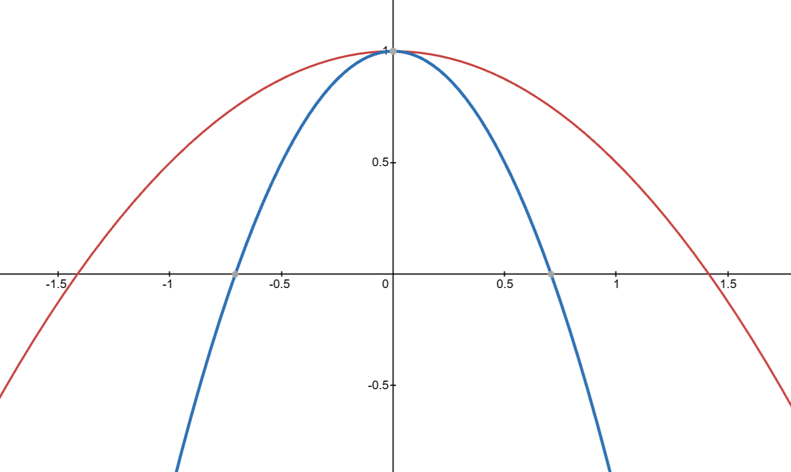
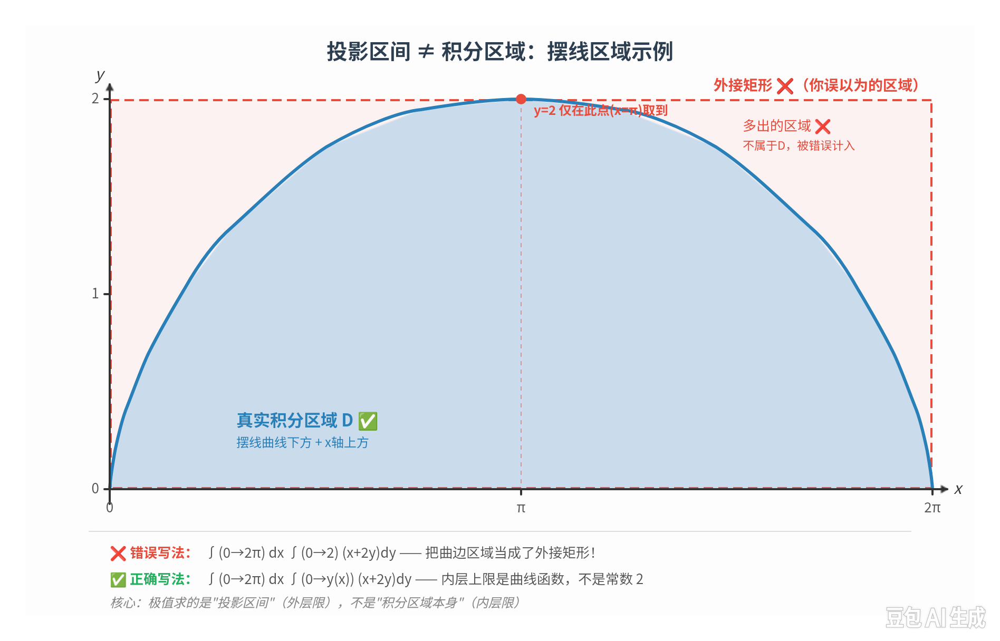

## 高数做题方法总结

1. 要熟练运用奇偶性、对称性来化简式子或者排除错误选项。
2. 对于选择题，要学会使用举例子或者带特殊值来辅助解题。
3. 发现一个技巧，大题中即使上一小问证明错误了，但是下一小问使用上一小题的结论依旧可以证明正确，总结：上一小问错误，不影响下一小问使用上一小问的结论进行证明。

## 不定积分坑点

每次求完**不定积分**，不要忘记给原函数加一个**常数项**$C$。

若函数是**分段函数**，记得要考虑**连续性**，从而去确定**常数项**$C$的取值。

## 反常积分判定敛散性

1. 式子能化简先化简
2. 再使用定义法或者判定法去判断

## 曲率的理解⭐

### 1. 直角坐标 $y = y(x)$
$$
K=\frac{|y''|}{\big(1+(y')^2\big)^{\frac{3}{2}}}
$$

### 2. 参数方程 $\begin{cases}x=\varphi(t)\\y=\psi(t)\end{cases}$
$$
K=\frac{|\varphi'(t)\psi''(t)-\varphi''(t)\psi'(t)|}{\Big[\big(\varphi'(t)\big)^2+\big(\psi'(t)\big)^2\Big]^{\frac{3}{2}}}
$$

### 3. 极坐标 $\rho=\rho(\theta)$
$$
K=\frac{|\rho^2+2(\rho')^2-\rho\rho''|}{\big(\rho^2+(\rho')^2\big)^{\frac{3}{2}}}
$$

### 曲率半径
$$
R=\frac1K
$$

### 曲率的几何含义

曲线的曲率表示曲线在某一切点处弯曲程度的数值。曲线的曲率越大，弯曲程度越大。

例如下方是$y=-0.5x^{2}+1$和$y=-2x^{2}+1$的图像.

* $y=-0.5x^{2}+1$的曲率是$\kappa = \frac{|y''|}{(1 + y'^2)^{3/2}} = \frac{1}{(1 + x^2)^{3/2}}$

* $y=-2x^{2}+1$的曲率是$\kappa = \frac{|y''|}{(1 + y'^2)^{3/2}} = \frac{4}{(1 + 16x^2)^{3/2}}$

## 微分方程解的性质

$$y' + P(x)y = 0 （*）$$

$$y' + P(x)y = Q(x)（**）$$

* 若有$y_1$和$y_2$是方程`*`的解，则$y_1$与$y_2$的线性组合也是`*`的解；

* 若有$y_1$和$y_2$是方程`**`的解，则$y_1-y_2$是`*`的解；

* 若有$y_1$和$y_2$是方程`**`的解，则$k_1y_1+k_2y_2$，当$k_1+k_2=0$时是`*`的解，当$k_1+k_2=1$时是`**`的解。

## 数学归纳法

1. 举实际例子看规律；
2. 假设规律为“巴拉巴拉”；
3. 代入验证假设，是否正确；
4. 最后归纳结论。

## 何为变化率

假设此时说点$P$的横坐标对时间的变化率为$v_0$，其实就是x关于t的导数，因此导数即变化率。

> 例子，2016年真题卷，填空题13题

## 注意定义域范围

所有定义域都要考虑，并且若有绝对值存在，还要情况讨论。

## 多元函数求极值

1. 对每个未知量进行求偏导；
2. 让每个偏导的隐函数为0，联立方程组求解；
3. 将解出来的值带回原方程确认其值；
4. 解出来的值都是驻点，不是极值点；
5. 需要将驻点一一代入原方程，确定最终的极值。

## 常见的几何函数

[link](/personal-website/notes/geometric-functions/)

## 一重积分与二重积分之间的转化

### 二重积分 → 累次积分
1. 直角坐标：选积分次序（X 型 / Y 型）
2. 极坐标：含 $x^2+y^2$ 或圆域时用，记得乘雅可比 $r$
3. 对称性 + 奇偶性简化计算

### 一重积分 → 二重积分（升维技巧）
1. 乘积升维：$\int_a^b f(x)\,dx \cdot \int_a^b g(x)\,dx = \iint_D f(x)g(y)\,dxdy$
2. 变量字母无关：$\int_a^b f(x)\,dx = \int_a^b f(y)\,dy$，配合轮换对称性
3. 不等式证明：平方/乘积凑成二重积分（如柯西-施瓦茨）

### 累次积分 → 一重积分
1. 交换积分次序
2. 变限积分升维后换序：$\int_a^b dx\int_a^x f(t)\,dt = \int_a^b f(t)(b-t)\,dt$

### 辅助工具
1. 轮换对称性：区域关于 $y=x$ 对称
2. 形心公式：$\iint_D x\,d\sigma = \bar{x}\cdot S_D$

## 矩阵相似与特征值的关系

相似可以得$P^{-1}AP=B$，即矩阵A的初等变换可以得到B，而初等变换不会影响矩阵A的秩，从而可以得到$r(A)=r(B)$。

## 判断两矩阵是否相似的

* 特征值是否相同
* 特征方程是否相同，特征方程的秩是否相同
* $|A|$和$|B|$是否相同
* $tr(A)$和$tr(B)$是否相同
* $f(A)$和$f(B)$是否相似

> 以上条件只有有一个不满足，两个矩阵就不是相似矩阵

## 矩阵秩的性质一定要好好背，这个考点太多了

我此时能记得的有：

* $r(A)=r(A^T)=r(A^{-1})=r(P^{-1}AP)$
* $A_{m,n}$和$B_{n, s}$，有$r(A)+r(B)-n\leq r(AB) \leq min(r(A), r(B))$
* $r(A)\pm r(B) \leq r(A)+r(B)$
* $AB=O$，则$r(A)+r(B) \leq n$
* $r(A,B) \geq max(r(A), r(B))$
* $r\binom{A}{B} \geq max(r(A), r(B))$
* 设$A_{m,n}$，$B_{m,n}$，若有$r(A)=n$，则$r(AB)=r(B)$;同理可得，若有$r(B)=n$，则$r(AB)=r(A)$;
* 设$A$为$n$阶非零矩阵，则$r(A)=1$的充分必要条件是存在非零列向量$\alpha, \beta$，使得$A=\alpha \beta^{T}$

## 求导时的注意点⚠️

注意求导的函数是不是复合函数，如果是一定要用链式法则求干净，这里容易发生计算错误

> 自己掉坑的题，2018年真题，解答题，题15

## 求微分方程的注意点⚠️

当微分方程中出现**不定积分表示原函数时**，当心自己解出来的答案是**不定积分原函数**，还是**不定积分原函数的导数**

> 自己掉坑的题，2018年真题，解答题，题16

## 二重积分·积分限的误解

> 错误来自真题2018年，解答题，题17

我轻廖把参数方程求得的极值当作二重积分的积分限，这是错的，两个方程的极值只能确定这个积分区域的投影范围，真实的区域可能是在这个矩形区域内的一个不规则图像。

> **核心一句话**
> 
>极值 / 最值，求的是区域在坐标轴上的【投影区间】，只适合做外层积分限；不能直接拿来当内层积>分限！

## 分段函数求导的坑点

特别是分段函数的分界点，因为此处求导左导与右导的**区间不一样**，**函数也不一样**，从而就需要分开来求导，最后用导数的定义**左导右导都有值且相同**此时导数才存在。

> 错题，2019年真题，解答题19题

## 微分方程解的概念，遗忘了

齐次微分方程与非齐次微分方程的解的形式，需要回顾，可以翻书或者问AI。

## 放缩法比较大小的相关题

> 题目列表
>
> 2019年真题，题5

## 两条直线在一点相切的含义（特殊知识点）

直线$y=f(x)$与直线$y=g(x)$在x=a点处相切，说明$f(a)=g(a),f'(a)=g'(a)$，但是不能说明$f''(a)=g''(a)$。

> 错题，2019年真题，题6

## 正交矩阵在题目中的含义

1. 正交矩阵**一定**可以**相似对角化**。
2. 正交矩阵的不同的特征值对应的特征向量，两两之间**一定**正交。
3. 正交矩阵**一定**可以**正交相似对角化**

## 定积分换元法与凑微分的区别⚠️

举便说明：

$$
✅\int_{0}^{2} x^{2} \cdot 2x \, dx
= \int_{0}^{2} x^{2} \, d\!\left(x^{2}\right)
= \left. \frac{x^{4}}{2} \right|_{0}^{2}
= 8
$$

$$
❌\int_{0}^{2} (t+1)^{2} \, dt
= \int_{0}^{2} (t+1)^{2} \, d\!\left(t+1\right)
= \left. \frac{(t+1)^{3}}{3} \right|_{0}^{2}
= \frac{26}{3}
$$

$$
✅\int_{0}^{2} (t+1)^{2} \, dt
= \int_{0}^{3} (t+1)^{2} \, d\!\left(t+1\right)
= \left. \frac{(t+1)^{3}}{3} \right|_{0}^{2}
= \frac{26}{3}
$$

第一个式子对，因为它进行的微分等价变换$\int_{x=a}^{x=b} f(\varphi(x))d\varphi(x)$。

第二个式子错，因为在进行积分计算时，$d\!\left(t+1\right)$属于**变量替换**了，原式子中是没有与$(t+1)$可以等价的微分式子，此处是换元操作，就需要进行上下限的改动。如果不改动上下限区间，就会导致结果错误，因为原式是对t这个变量进行求积分，后式是对t+1这个变量进行积分，**积分变量变了，上下限也要跟着变**。**重点**⚠️，第一个式子$d$后面的东西变了，但本质上，上下限式子的变量没有变，我只是把原来求**积分的变量x**变成了关于**x的表达式$\varphi(x)$**

**最简区分两条路线**

路线 A（凑微分、不设 u，你想用的这个路线）

1. $\int_{x=a}^{x=b} f(\varphi(x))d\varphi(x)$
2. 用整体法写出原函数：$\Phi(\varphi(x))$
3. 计算 $\boldsymbol{\Phi(\varphi(b))-\Phi(\varphi(a))}$ ✔

路线 B（正式换元、设 $u=\varphi(x)$）

1. 令 $u=\varphi(x)$
2. 算出 $u_1=\varphi(a),u_2=\varphi(b)$
3. $\int_{u=u_1}^{u=u_2} f(u)du$ ✔

## 向量组等价的充要条件

① 定义法：相互线性表示
$$
\boxed{\mathrm I\cong\mathrm {II}\iff
\begin{cases}
\mathrm I\text{可由}\mathrm {II}\text{线性表示}\\
\mathrm {II}\text{可由}\mathrm I\text{线性表示}
\end{cases}}
$$

② 秩的判定法（考研最常用）
记：
$$
A=(\alpha_1,\ldots,\alpha_m),\quad
B=(\beta_1,\ldots,\beta_n)
$$

则：
$$
\boxed{\mathrm I\cong\mathrm {II}\iff
r(A)=r(B)=r(A,B)}
$$

其中 $r(A,B)$ 表示将两个向量组的所有向量合并后组成矩阵的秩。

## 结尾

未完，待续。。。