## 硬布线&微程序控制

硬布线

优点：因为它是组合逻辑电路，硬件直接响应，因此它的速度快。
缺点：难以扩展，当指令非常多时硬件电路会非常庞大；不好修改，每次修改后都需要重新设计硬件电路逻辑，修改成本太高。

微程序控制

优点：灵活性高，可维护性强。
缺点：每条微指令需要从控制存储器中去读取，导致微指令的执行需要的微周期数增加，从而影响执行速度。


微程序控制执行过程

1、将指令中的OP部分提取出来，交给微程序控制器中。
2、由微地址形成部件生成微指令的地址交给uPC。
3、由uPC告知控制存储器要取的微指令的地址在哪，取哪条微指令，并将微指令交给uIR。
4、uIR通过读取微指令中微命令部分的内容执行操作，再将微指令中下地址部分的内容交给微地址形成部件。

## 多总线结构

双总线结构 = 存储器总线（主存总线）+I/0总线

三总线结构 = 存储器总线 + I/0总线 + DMA总线

## 操作系统的进程调度

进程调度算法：FCFS（先进先出）算法、SJF（短作业优先）算法、高响应比优先算法、优先级调度算法、时间片轮转调度算法、多级队列调度算法、多级反馈队列调度算法

## 操作系统连续内存空间分配

连续内存分配算法：优先分配、邻近分配、最佳适应、最坏适应、基于索引的分配算法

## 三种网络参考模型

408 计算机网络中常考三种：**OSI 七层模型、TCP/IP 四层模型、五层参考模型（折中模型）**

## 最佳归并树（k 路归并）虚段计算公式

> m：**初始归并段数量**；k：归并路数
> 公式：
> 
> 
> $u=(m-1)\bmod(k-1)$
> 
> 
> 1. 如果 $\boldsymbol{u=0}$：**不需要虚段**，直接构造严格 k 叉哈夫曼树（最佳归并树）
> 2. 如果 $\boldsymbol{u\neq0}$：需要补充 $\boldsymbol{(k-1)-u}$ 个**虚段**（虚段权值 = 0）

> 
> 原理一句话：**最佳归并树必须是严格 k 叉树（每个分支结点都恰好有 k 个孩子）**。严格 k 叉树的叶子结点数量 $n_0$ 必须满足 $(n_0-1)\%(k-1)=0$。初始归并段就是叶子；不够就补权 = 0 的虚叶子（虚段）。

### 推导简单看（理解用，考试直接套公式）

严格 k 叉树的性质：

$n_0 = (k-1)n_k + 1$

$n_0$：叶子总数（真实段 + 虚段）；$n_k$：分支结点数目。

变形得到：$(n_0-1)$ 一定能被 $(k-1)$ 整除。

我们已有 m 个真实叶子。若 $(m-1)$ 除以 $(k-1)$ 有余数，就要补虚段，把总叶子数凑成满足这个整除条件的最小数。

## 地址变换机构（包含缺页中断处理）

> 见书《27操作系统》P214

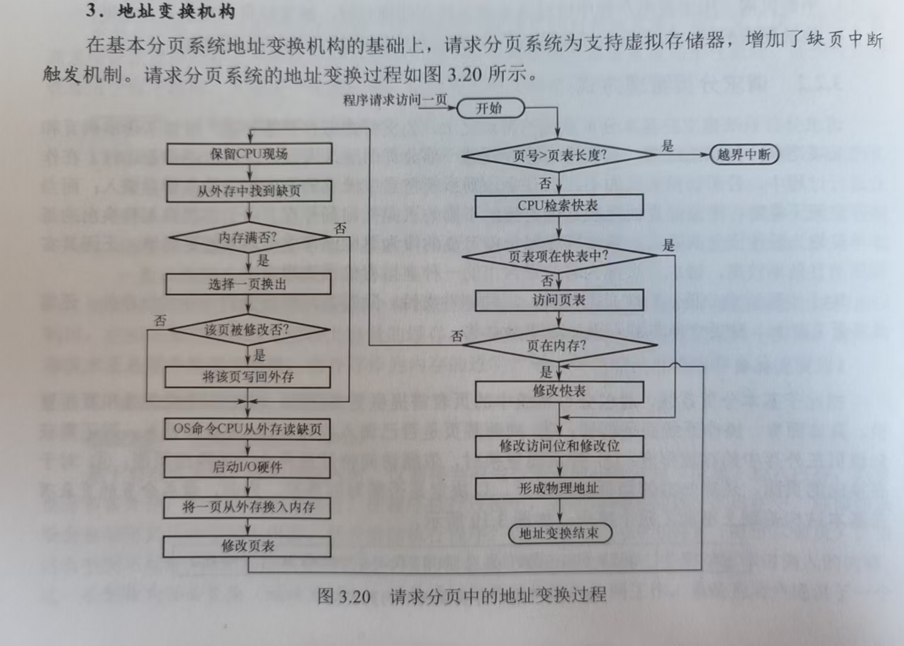

## 时钟脉冲知识点回顾

* 晶振脉冲经整形、分频，生成 CPU 时钟脉冲。
* 时钟脉冲宽度即时钟周期；主频 = 1 / 时钟周期。
* 时钟周期由流水线组合逻辑最大延迟决定。

> 哪里不懂，具体问AI吧

## 线程概念考点的回顾

**进程**的诞生是为了解决多任务并发执行的问题，而**线程**的诞生是为了进一步降低并发执行的**开销**。

**线程**分为 **用户组线程** 与 **内核级线程** ：

* 用户级线程由用户空间的线程库进行创建与管理
* 内核级线程由内核空间的操作系统进行创建与管理

同一进程中的多个线程是共享进程资源的，但是线程的阻塞可能会导致其它线程也被阻塞，整个进程被挂起，为解决这个问题引入了**多线程模型**

* N对一模型，多个用户级线程对应一个内核级线程
  - 优点：线程切换在用户空间完成，开销小。
  - 缺点：线程阻塞会使用其它所有线程一起阻塞。
* 一对一模型：每个用户级线程都对应一个内核级线程
  - 优点：一个线程阻塞不会影响其它线程的执行，提升线程之间的并发性
  - 缺点：线程切换是在内核空间完成的，变成了内核级线程的切换，开销大
* N对M模型，N>=M,多个用户级线程对应一个内核级线程
  - 优点：是上面两种模型优点的折中型。

## 动态分区算法的回顾 

| 算法         | 空闲链表排序 | 核心思路           | 碎片                 | 大作业支持 | 查找开销       |
| ------------ | ------------ | ------------------ | -------------------- | ---------- | -------------- |
| 首次适应     | 地址递增     | 从头找第一个够大   | 较多（低地址小碎片） | 较好       | 一般           |
| 循环首次适应 | 地址递增     | 上次位置往后循环找 | 较多                 | 差         | 较小           |
| 最佳适应     | 容量升序     | 最小够用块         | **最多**             | 好         | 大（维护有序） |
| 最坏适应     | 容量降序     | 最大空闲块分配     | 较少                 | **最差**   | 大（维护有序） |

## B树的建造方法回顾

建造一个m阶的B树。

1. 将关键字按大小放在对应的结点中
2. 若结点中关键的数量超过了m-1，则将$\lfloor m/2 \rfloor$位置上的关键字提取出来，将其移至父结点中。
3. 当父结点中因2)移入新结点时，同样可能会发生2)的情况，直到B树稳定。

> K阶B树，最多有$m$棵子树，$m-1$个关键字，最少得有$\lceil m/2 \rceil$棵子树，$\lceil m/2 \rceil - 1$个关键字
> 
> 可供参考的视频，请看[【这里】](https://www.douyin.com/video/7552005514852388147)

## B树的删除

> 话不多说，上[视频](https://www.bilibili.com/video/BV1JU411d7iY)
>
> 一个精练的视频胜千言

## B树的基本概念

假设现有m阶B树

* B树除根节点可以至少有1个关键字外，其余非叶节点应至少有$\lceil m/2 \rceil$个子树和$\lceil m/2 \rceil -1$个关键字。

## B树与B+树的区别

在B树中分支结点会存储记录，但是在B+树中分支结点就不会存放数据，只有叶子结点才会存储数据，并且除第一叶子结点外，每个叶子结点的首结点都会有其父结点或者祖先结点对应。

> 具体过程，可以看[视频](https://www.iesdouyin.com/share/video/7690114146435665202/?region=CN&mid=7690114143122197299&u_code=0&video_share_track_ver=&titleType=title&share_sign=v8GvBl_YC29zKfK.MImM5oDdlD8xHiYFeWybtcf4lao-&share_version=15020040&ts=1791532557&from_aid=482431&from_ssr=1&share_track_info=%7B%22link_description_type%22%3A%22%22%7D)
>
> [视频2](https://www.iesdouyin.com/share/video/7668477862761100273/?region=CN&mid=7668477887921867546&u_code=0&video_share_track_ver=&titleType=title&share_sign=xwsfdCQDRyOY.kskQjmpR7c7_JGqCBogJi3sNilBxhQ-&share_version=15020040&ts=1791532557&from_aid=482431&from_ssr=1&share_track_info=%7B%22link_description_type%22%3A%22%22%7D)

## 处理器类型及相关问题

单周期CPU：
* CPI为1
* 时钟周期由执行时间最长的那条指令来决定
* 时钟频率低

多周期CPU：
* CPI一般都大于1
* 指令被拆分成多个阶段，每个阶段一个周期
* 时钟频率会高一点
* 时钟周期由各个阶段中执行时间最长的时间来决定
* 依旧是串行执行指令，没有并行

基本流水线CPU：
* 理想无阻塞的情况下，CPI为1
* 可并行执行指令
* 会有**冒险**问题

超标量流水线CPU：
* 比流水线不同的是，每个阶段可以有多个相同的部件并行执行，以加快指令的执行速度

## 中断处理与中断响应优先级的概念

当中断来临，首先会由中断屏蔽字来觉得响应哪个中断，通过中断屏蔽字的筛选后，再由中断判优机构来决定处理哪个中断。（我的回忆，这是错误的）

正确版：
### 1. 中断判优机构（硬件判优：中断排队电路）

**发生时机：多个中断源同时发中断请求 IR 的时候**
作用：**选出优先级最高的那个中断请求**，把它送到 CPU 的中断请求输入端。

- 硬件判优：链式排队电路、独立请求总线判优。
- 判优只做一件事：**多个中断同时到来，谁优先级高，谁获得请求信号**。

> 
> 判优，是**选择哪个中断请求被提交给 CPU**。

### 2. 中断屏蔽字（中断屏蔽寄存器 IMR）

**发生时机：CPU 准备响应中断的时候（或者中断服务程序内部）**
中断屏蔽字每一位对应一个中断源：

- 屏蔽位 = 1：屏蔽，这个中断就算来了，也不能打断当前执行；
- 屏蔽位 = 0：开放，可以响应。

核心：**屏蔽字决定：当前 CPU 环境下，能不能响应这个中断**。
屏蔽字可以动态修改！这就是**动态改变中断优先级**的原理。

> 
> 屏蔽字不是用来 “挑选多个中断里谁优先级最高”，而是**控制是否允许该中断打断现场**。

> 我的总结就是：中断->中断判优->中断屏蔽字。
>
> 中断判优，决定中断请求信号归谁。在**同一时刻有多个中断源同时发请求**的时候，从这一堆请求里，**选出硬件静态优先级最高的那一个中断源**，产生一个**送到 CPU 的公共中断请求信号 INTR**。
>
> 中断屏蔽字，决定当前CPU处理哪个中断

## DMA 与 CPU 访存冲突的 3 种方案

1. 停止CPU访问内存
2. 周期挪用/周期窃取
3. DMA与CPU交替访存（时间分片、分时访问）

> 具体内容，自己人脑回忆，不再展开，可以问AI
>
> 错题，见2020年真题，题22

## 内存分配分类

```
存储管理
├─ 连续分配方式
│  ├─ 单一连续分配
│  ├─ 固定分区分配（静态分区）
│  └─ **动态分区分配（可变分区分配）**
└─ 非连续分配：分页、分段、段页式
```

> 例题，2020真题，题24
>
> 此题让我意识到，我自己现在对知识的体系框架已经有点乱了

## 乘法运算的实现

> 核心本质：乘法 = 加法 + 移位

无符号乘法（原码一位乘法，仅绝对值运算）
✅适用：无符号数、原码数值位相乘；符号位单独异或
寄存器：A (部分积，初 0)、B (被乘数)、Q (乘数)，A+Q 存 2n 位结果
循环 n 次（n = 数值位位数）

1. 看 Q 最低位$Q_0$
   - $Q_0=1$：A = A + B
   - $Q_0=0$：A 不变
2. A、Q 联合【逻辑右移】
结束：A 存乘积高 n 位，Q 存乘积低 n 位
考点短句：逻辑右移；只看 1 位；无符号；循环 n 次；符号单独处理

有符号乘法（Booth 补码乘法，大题重点）
✅适用：补码有符号数，符号位直接参与运算，无需单独求符号
寄存器：A (部分积，初 0)、Q (乘数)；乘数增设附加位$Y_{n+1}$，初始为 0
循环 n 次

1. 判断 Q 末位$Y_n$和附加位$Y_{n+1}$（两位）
   - 00、11：不加
   - 01：A += $[X]_{补}$
   - 10：A += $[-X]_{补}$
2. A、Q、附加位一起【算术右移】
考点短句：算术右移；看末尾两位 + 附加位；有符号补码；循环 n 次

阵列乘法器（选择题｜并行乘法）

- 无符号并行乘法，组合逻辑电路，无循环移位，速度最快，硬件开销大
- n 位 ×n 位 → 输出 2n 位乘积

## 树的路径长度相关概念（包含哈费曼树）

1. **WPL（带权路径长度）**：$\boldsymbol{WPL=\sum w_i l_i}$
   - $w_i$：叶子权值（**频次，不是概率**）
   - $l_i$：根到叶子的路径边数 = 哈夫曼编码的码长
   - 含义：**总比特数**。如果权是各个字符出现多少次，WPL 就是把整篇文本编码完一共多少位。
  > 一句话：WPL = **总和**
2. **哈费曼树的加权平均长度**：$\bar L=\frac{\sum w_i l_i}{\sum w_i}=\frac{\text{WPL}}{\text{总频次}}=\sum p_i l_i$
   1. 这里 $p_i=\dfrac{w_i}{\sum w_i}$，是字符出现概率。
   > 一句话：加权平均码长 = **平均每个字符占多少比特**
   > 对应真题，2023年真题，题4
3. **路径长度**：用于配合 WPL 定义和哈夫曼编码（如 "等长 vs 变长编码总长度"）。根到第K层的结点，它的路径长度就是K-1
4. **ASL 与路径长度的关系**：二叉排序树查找成功 ASL = 各结点路径长度之和 /n（等价于平均比较次数），这是查找章节的高频考点

> 错题，2021真题，题5

## AVL树的插入与删除

> 该复习了，具体知识点内容太多，我就不在这儿详细展开，具体内容直接问AI吧

## 堆的插入与删除操作

* **堆的插入**：在堆的末尾插入，逐层进行向上调整的操作；
* **堆的删除**：将堆顶删除，将堆的末尾放入堆顶，逐层向下进行操作；

## 存储器对程序员可见性的分类

对程序员可见：基址寄存器、变址寄存器和标志/状态寄存器、通用寄存器、程序计数器PC

对程序员不可见：MAR、MDR、IR、微指令寄存器

## 总线事务与定时

这是《组成原理》第六章总线部分的概念，有时间一定要重新看视频回顾一下。

## 进程的五态模型

> 直接看这笔记，[详细](/personal-website/notes/the-five-state-model-of-os-processes/)


## 物理层的编码方式（忘记了看看）

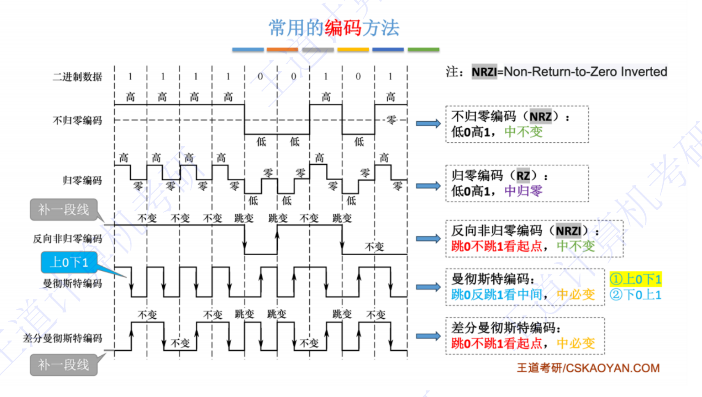

## 四次挥手的不同阶段

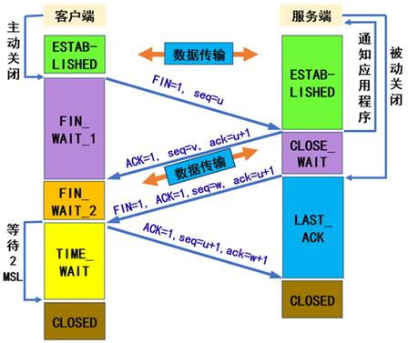

## TCP和UDP首部内容与长度

TCP首部是20B~60B

UDP首部固定是8B

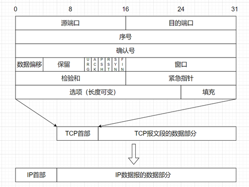

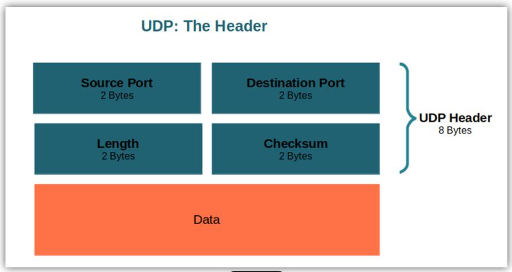

## 外部排序流程

1. 读入外存数据生成初始归并段，使用置换-选择算法来优化初始归并段的生成；
2. 进行K路归并，将K路归并段合并成一个新的更加长的归并段，直到只剩下唯一的归并段。使用败者树来优化这个归并过程；
3. 通过哈弗曼树来优化归并树，从而减少磁盘I/O次数，优化后的归并树叫作最佳归并树

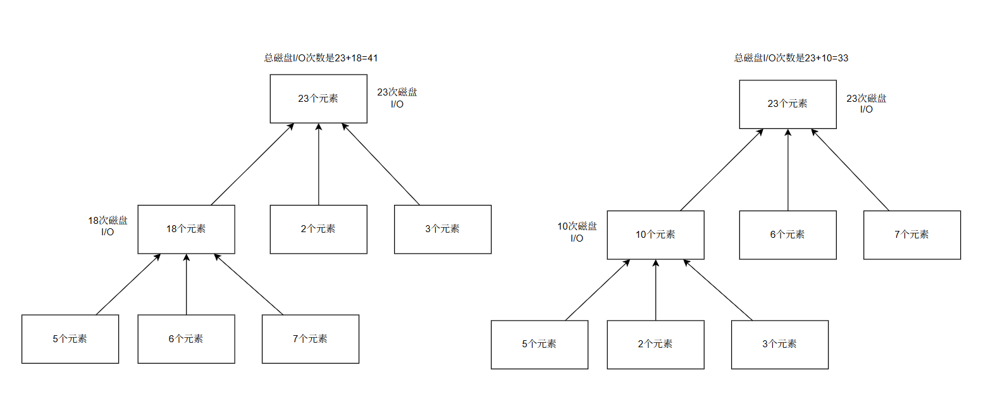

## 指令集体系结构（ISA） 规定的内容

1. **指令格式**：操作码 OP、地址码字段，指令长度、定长 / 变长指令
2. **指令集**：可以执行的指令种类（算术、逻辑、访存、转移、IO 等）
3. **寻址方式**：有效地址怎么计算（立即、直接、间接、基址、变址、相对寻址等）
4. **寄存器定义**：程序员可见寄存器（通用寄存器、PC、PSW / 状态寄存器），寄存器位数
5. **数据类型**：硬件直接支持的数据类型（字节、半字、字、双字、浮点数等）
6. **存储器编址**：地址空间大小、编址单位（按字节编址 / 按字编址）、地址含义
7. **中断与异常机制**：异常类型、中断向量、程序状态、中断返回相关定义
8. **I/O 模型**：是存储器映射 I/O，还是独立 I/O 指令（IN/OUT）

## ❌ ISA**不规定**（选择题高频坑点）

- 流水线结构、Cache 大小、总线时序、ALU 实现、微指令、寄存器堆硬件电路

> 这些属于**微体系结构（微架构）**，同一 ISA 可以有不同硬件实现（例如 x86 ISA，Intel 和 AMD 不同 CPU）

## 驱动程序的作用

① 将上层 I/O 请求转换为设备控制器可识别的命令；

② 读写控制器寄存器，控制设备完成 I/O 操作；

③ 响应设备中断，处理 I/O 完成后的善后工作；

④ 检查请求合法性与设备状态，管理 I/O 请求队列；

⑤ 进行必要的数据格式转换，屏蔽底层硬件控制器差异，为上层提供统一访问接口。

> 2022年真题，题32

## 最大数据传输率与码元调制技术之间的关系

$log_{2}(码元的表示状态数)=每个码元携带的比特数$

调制技术有3种：

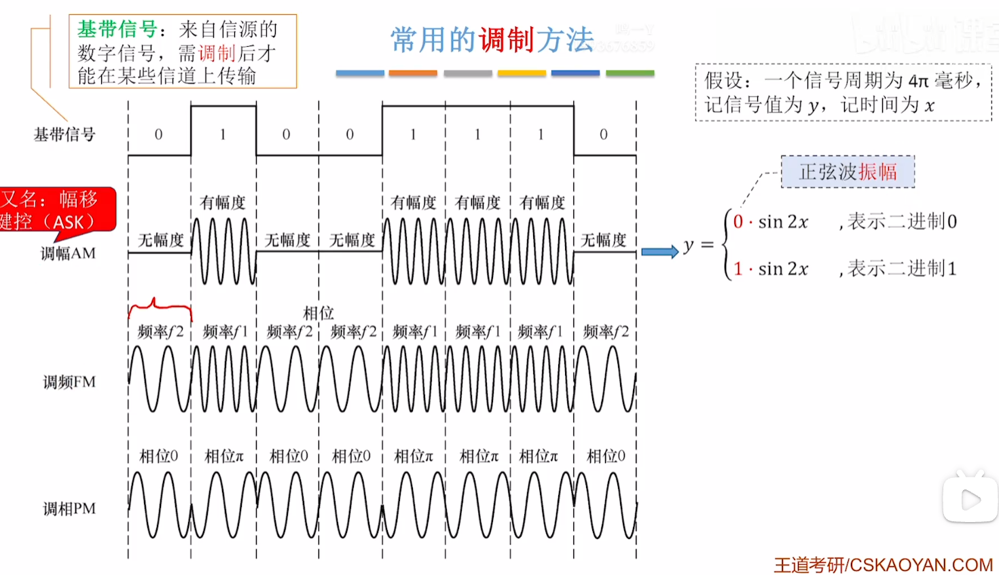

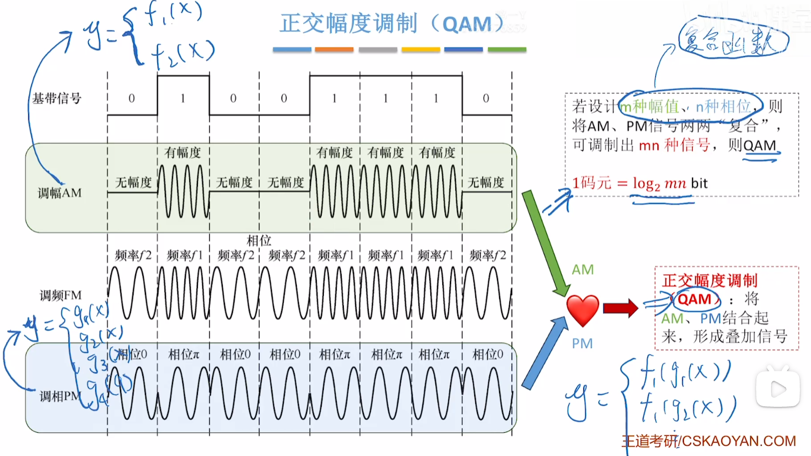

无噪声下，$最大数据传输速率=2W$（码元为单位），$最大数据传输速率=2W*log(码元状态数量)$（比特为单位）

有噪声下，$C = W \log_2\left(1 + \frac{S}{N}\right)
$

信噪比分贝值与功率比之间的换算公式：

$$
\mathrm{SNR_{dB}} = 10 \log_{10}\left(\frac{S}{N}\right)
$$

## SDN网络体系结构

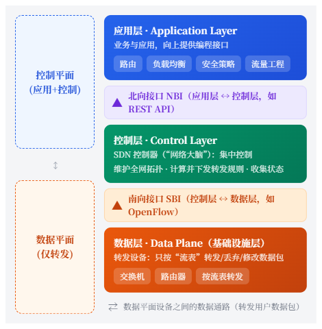

## DHCP四次报文的名称是什么

| 顺序 | 报文             | 方向          | 作用               |
| ---- | ---------------- | ------------- | ------------------ |
| 1    | Discover（发现） | 客户端 → 广播 | 寻找 DHCP 服务器   |
| 2    | Offer（提供）    | 服务器 → 单播 | 提供 IP 地址等配置 |
| 3    | Request（请求）  | 客户端 → 广播 | 确认选用该地址     |
| 4    | ACK（确认）      | 服务器 → 广播 | 确认分配并给出租期 |

## 三元组存储稀疏矩阵M

```c++
typedef struct {
  int i; // 行坐标
  int j; // 列坐标
  ElementType Elemv; // 元素的值
}
```

```c++
#define MAXSIZE 100 // 最多的非零元素
typedef struct {
  ElementType data[MAXSIZE]; // 非零元素集合
  int nu; // 原矩阵的行数
  int mu; // 原矩阵的列数
  int tu; // 原矩阵的非零元素的个数
}
```

> nu和mu是用来**还原稀疏矩阵**的，有这两个数据我们就能知道原矩阵的大小，tu表示data数组的**有效数据个数**。

## 排序算法（不稳定算法）

**口决：快选堆希（不稳定），插冒归基（稳定）**

## 指令流水线的冒险问题

具体可以看《计组强化P4_指令流水线解题技巧总结》

## 总线的数据传输过程（含突发传输）

常规情况下，总线传输一个数据需要“传地址+准备数据+传数据”这三个过程，当有多个数据需要进行传输时，就会变成“传地址+准备数据+传数据”+“传地址+准备数据+传数据”。。。这样的过程。

在支持突发传输后，总线传输多个数据就不一样了，突发传输能去在一段时间内直接传输一整个**磁盘块**（就是一整个DRAM的缓冲区大小），也就是把之前**“传地址+准备数据+传数据”+“传地址+准备数据+传数据”。。。**的过程，压缩成了一个**“传地址+准备数据+传数据”**这样的过程。

## 出栈序列的个数

**卡特兰数**：$\boldsymbol{C_n=\frac{1}{n+1}\dbinom{2n}{n}}$

## CSMA/CD的二进制指数退避算法

假设冲突发生了k次

> 前提：以太网CSMA/CD，发生冲突之后执行退避，**争用期（时隙）= 2τ**

假设冲突发生了 k 次：

1. 随机等待争用片的个数范围是 $\boldsymbol{[0,\;1,\;2,\;3,\dots,\;2^k - 1]}$
   - 从这个整数集合里**等概率随机选一个数 r**
   - 实际等待时间：$\boldsymbol{r \times 争用期}$
2. 注意 k 有上限：$\boldsymbol{k=\min(实际冲突次数,\;10)}$
   - 冲突次数 ≤10：k 等于冲突次数，区间上限 $2^k-1$ 随冲突次数指数变大
   - 冲突次数 11~15：k 固定取 10，上限固定为 $2^{10}-1=1023$，不再继续放大
3. 最多冲突**16 次**：连续冲突达到 16 次，直接丢弃该帧，向上层报告发送失败

**若是题目中没有给出争用期（时隙）的大小，则可以通过下面的方法来求：**

争用期（时隙 slot time） = $\boldsymbol{2\tau}$
$\tau$：**单程最大传播时延**
$\tau = \frac{\text{总线最大长度} \ L}{\text{信号传播速率} \ v}$
$\boldsymbol{\text{争用期}=2\tau=\dfrac{2L}{v}}$

> 
> 含义：信号从一端跑到另一端是 $\tau$；冲突信号跑回来被发送方感知到，来回一趟就是 $2\tau$。
> CSMA/CD 规定：**时隙 = 2τ**，发送方必须在 $2\tau$ 之内收到冲突信号。

## 各种校验码

[link](/personal-website/notes/summary-of-the-four-major-verification-methods/)

## IPV6相关知识点

[link](/personal-website/notes/list-of-key-ipv6-concepts/)

## FTP的工作流程

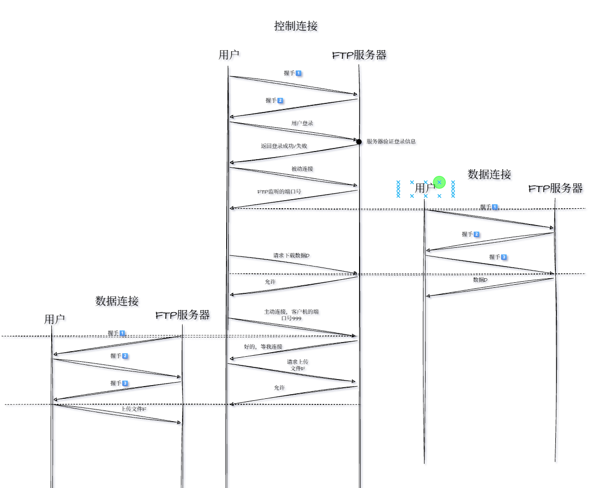

## scanf输入硬件实现全流程图

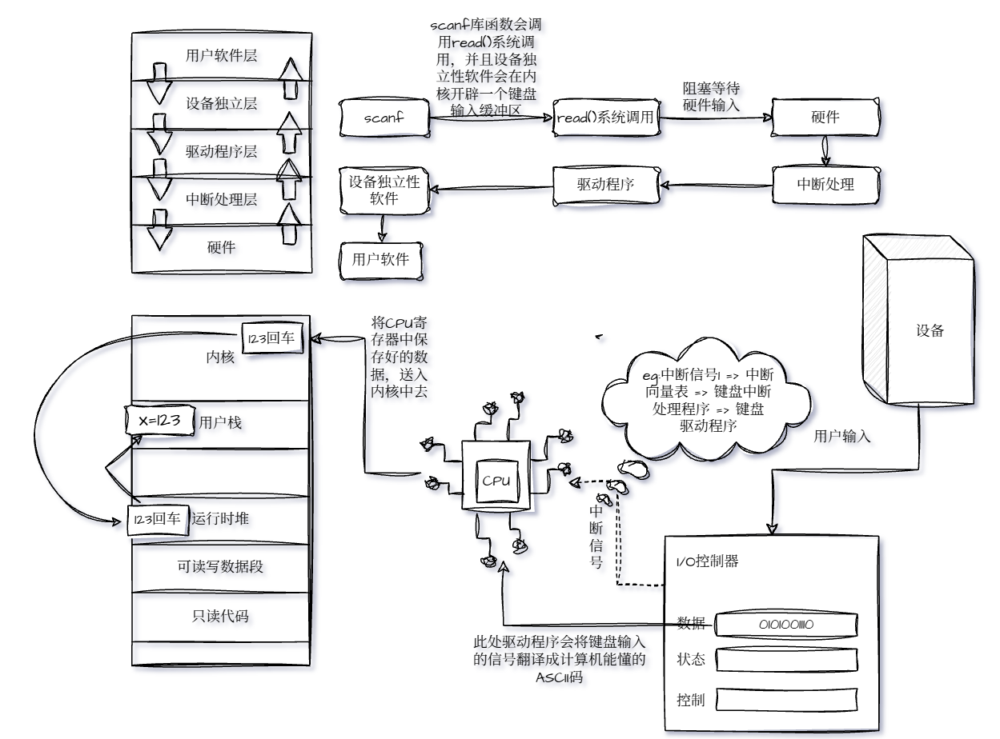

I/O控制器中数据只保存到CPU来读之前，CPU一旦开始读取它的数据，那么就会把这些数据读空，CPU通用寄存器组中的数据只是一个暂时的中转站，为了将键盘输入的符号转成ASCII码后，再发给内核缓冲区

## 前中后缀表达式的计算过程

[link](/personal-website/notes/prefix-infix-and-postfix-expressions/)


## KMP算法流程

**next数组（基础版）**：模式串的`next[j]`数组基本版本，表示以`j`下标结尾的最长公共子串长度

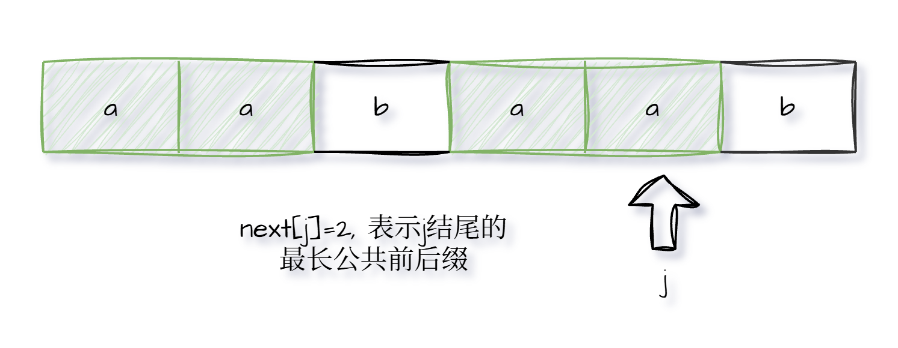

**next数组（移位版）**：考研常考的`next[j]`版本，表示以`j`下标结尾的最长公共子路前缀子串的下标，例如`ababa`子串它的`next[3]=next[1]`

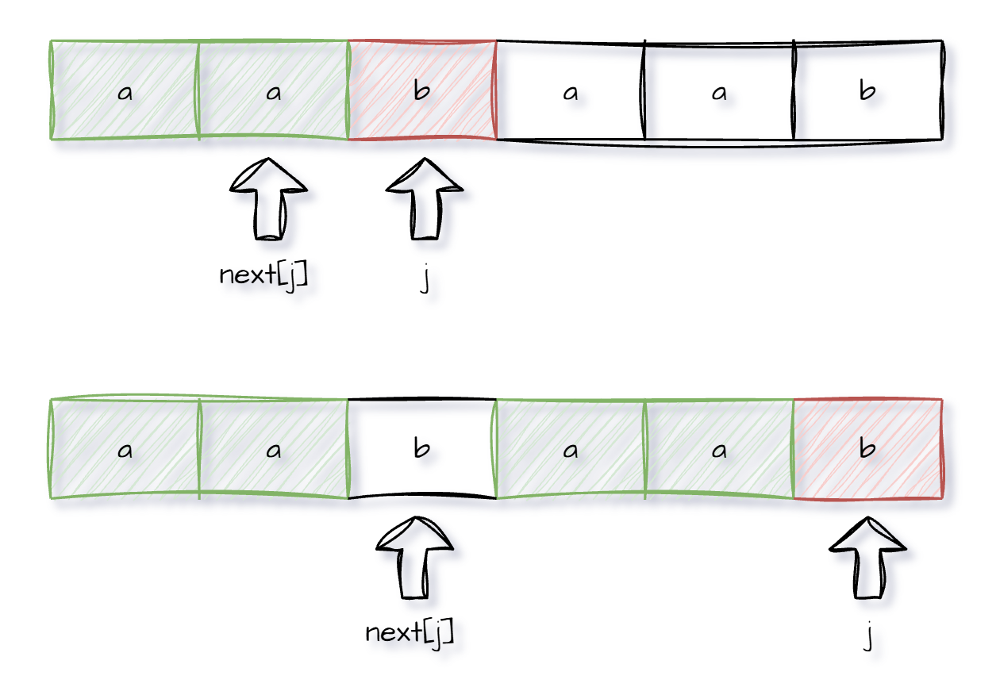

**nextval数组**：这个数组是在`next`数组（移位版）的优化，避免了重复比较。

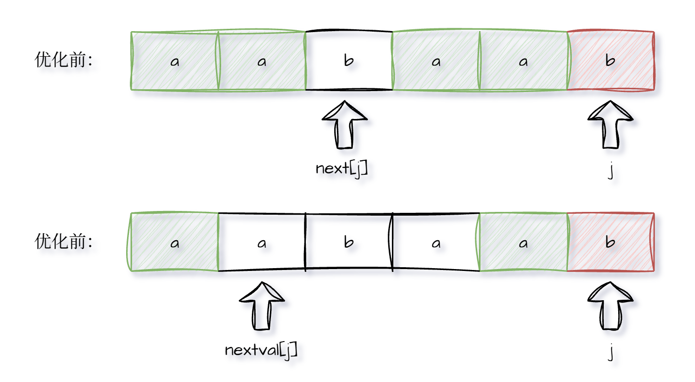

优化前，我们会拿`next[j]`所指的元素进行下一次比较，而`j`和`next[j]`所指的元素都是`b`必然还是失败。

优化后，我们拿`next[next[j]]`即`nextval[j]`来进行下一次的比较，此时`nextval[j]`与`j`所指元素已然不同，则会有新的可能，从而提高比较的效率。

## “MMU”术语的含义

其实就是指**虚拟地址**转换成**物理地址**

## 最大数据传输速率与实际传输速率的别名

**最大数据传输速率**是指$时钟频率\times 总线宽度 \times 一个时钟周期传输多少次数据$

**实际数据传输速率**是指$一次数据传输的量/传输的总耗时$

**最大数据传输率**的别名：

- 最大数据传输率
- 总线带宽
- 标准数据传输率
- 峰值带宽

**实际数据传输速率**的别名：

- 实际数据传输速率
- 有效数据传输速率
- 某某传输的平均数据传输率
- 有效吞吐量

## 文件系统调用的那些事儿

[link](/personal-website/notes/all-about-file-system-calls/)

## 磁盘调度算法归纳

[link](/personal-website/notes/summary-of-disk-scheduling-algorithms/)

## ASK、PSK、FSK、DPSK术语含义

ASK：幅移键控（Amplitude Shift Keying）

PSK：相移键控（Phase Shift Keying）

FSK：频移键控（Frequency Shift Keying）

DPSK：差分相移键控（Differential PSK）

## 各协议的最终检验和计算方法

拿UDP举例：

UDP 校验和是**16 位二进制反码求和**：

1. 把所有 16bit 分组做**反码加法**（按位加，有进位就把进位加到最低位，回卷进位）
2. 全部加完之后，**对总和按位取反**，才是 UDP 校验和

**完整四步流程（默写版）**

1. 构造伪首部（拿 IP 头里的源 IP、目的 IP、协议号、UDP/TCP 长度组装）
2. 把【伪首部 + UDP/TCP 头 + UDP/TCP 数据】拼接起来；奇数末尾补 0，对齐 16bit
3. 所有 16bit 分组依次做**反码加法**，溢出的最高进位回卷加到最低位
4. 全部累加完成后，对总和按位取反 → 这个结果就是校验和

> 相关真题，2024年真题，选择题，题39

## BGP协议

BGP协议分为外部BGP（eBGP）和内部BGP（iBGP）

BGP的报文类型：

- OPEN（打开）报文：用来和相邻的BGP区域边界路由器建立关系，进行通信初始化。
- UPDATE（更新）报文：用来通告路由器，以及列出需要更新的多条路由。
- KEEPALIVE（保活）报文：用来周期性的证实临站的连通性。
- NOTIFICATION（通知）报文：用来发送检测到的差错。

**BGP路由选择**

1. 根据偏好值：通常由路由器管理员来设定，会考虑经济、政治因素。
2. AS跳数最少：就是经过的AS自治系统数量最少。
3. 热土豆算法：就是最快逃离当前AS自治系统的路径。
4. AS边界路由器标识符最小：通常标识符最小的路由器最老，老的肯定比小的能干。标识符通常是由路由器的接口中IP地址最大决定。发送BGP报文时路由器之间会相互告之路由器的ID。

## 操作系统启动流程

> 极简背诵版：POST上电自检 -> BIOS启动读取磁盘的MBR -> 通过MBR找到活动分区，在活动分区里找到PBR -> 由PBR找到当前活动分区内操作系统的引导管理器 -> 引导管理器去拉起内核 -> 内核初始化

## VFS 的作用是什么？

>参考答案：
>
>虚拟文件系统 VFS 是操作系统内核提供的文件系统抽象层，向上为应用程序提供统一的文件访问系统调用接口；向下屏蔽不同底层文件系统（ext4、NFS 等）的实现差异，使得不同类型文件系统可以在内核中以一致方式管理，实现文件系统无关的 IO 操作。


## HDD（温彻斯特机械硬盘） vs SSD（固态硬盘） 408选择题速记表
| 对比项                | HDD（温彻斯特硬盘）            | SSD（固态硬盘）                   | 考点提示                         |
| --------------------- | ------------------------------ | --------------------------------- | -------------------------------- |
| 存储介质              | 磁粉、磁道、扇区               | NAND Flash闪存芯片                |                                  |
| 寻道                  | ✅ 有寻道时间（磁头移动）       | ❌ 无寻道，无磁头                  | 2025-32 C选项考点                |
| 旋转延迟              | ✅ 有（盘片转动）               | ❌ 无旋转延迟                      |                                  |
| 访问延迟              | 延迟大，不同位置访问差异大     | 延迟小，随机访问速度接近顺序访问  |                                  |
| 磨损均衡Wear Leveling | ❌ 不需要                       | ✅ SSD固件实现，**不属于文件系统** | 2025-32 D选项考点                |
| 扇区                  | 硬件低级格式化划分扇区         | 硬件有物理页/块，也有扇区接口     | **扇区是硬件层面，不是文件系统** | 2025-32 A选项考点 |
| 盘块（逻辑块/block）  | 文件系统高级格式化确定盘块大小 | 文件系统同样要确定盘块大小        | **文件系统功能，两者都要**       | 2025-32 B选项考点 |
| 读写单位              | 扇区（硬件）                   | 页读、块擦除（Flash特性）         | 擦除粒度大于读写粒度，高频考点   |
| 碎片影响              | 碎片会显著降低速度（寻道变多） | 碎片对速度影响很小                |                                  |
| IO调度算法            | 电梯算法SSTF、SCAN等有效       | SSD下IO调度收益很低，一般禁用     | 选择题常考                       |
| 断电数据保存          | 靠磁介质，断电不丢             | Flash非易失，断电不丢             | 两者都是非易失                   |
| 并行访问              | 受机械结构限制                 | 可多通道并行，速度更高            |                                  |

**核心口诀（直接背）**
温彻斯特就是机械盘，有磁头、有寻道、有旋转延迟；
SSD无寻道，页读块擦，磨损均衡在固件；
扇区硬件定，盘块文件系统定。

**易混坑清单**
1. ❌ 磨损均衡不是操作系统/文件系统做的，是SSD控制器固件
2. ❌ 文件系统不能减少SSD寻道时间，SSD根本没有寻道
3. ✅ 不管HDD还是SSD，上层文件系统都要定义逻辑盘块
4. ❌ 低级格式化划分扇区，高级格式化是文件系统建分区、确定盘块、建FS

## 电路交换、报文交换、分组交换的数据传输的区别

> 2025年真题，选择题，题33

- **电路交换**：它不需要存储转换操作，只需要确定物理传输电路（建立电路），传输速率由最小的传输速率决定
- **报文交换**：它需要存储转发操作，但是它是一整个报文一次性存储下来后，再转发，传输速率由它当前的传输介质的传输决定。
- **分组交换**：它需要存储转发操作，与**报文交换**不同的是它会将一整个报文进行分组后再转发，它的传输速率需要具体计算，分析法如图所示：

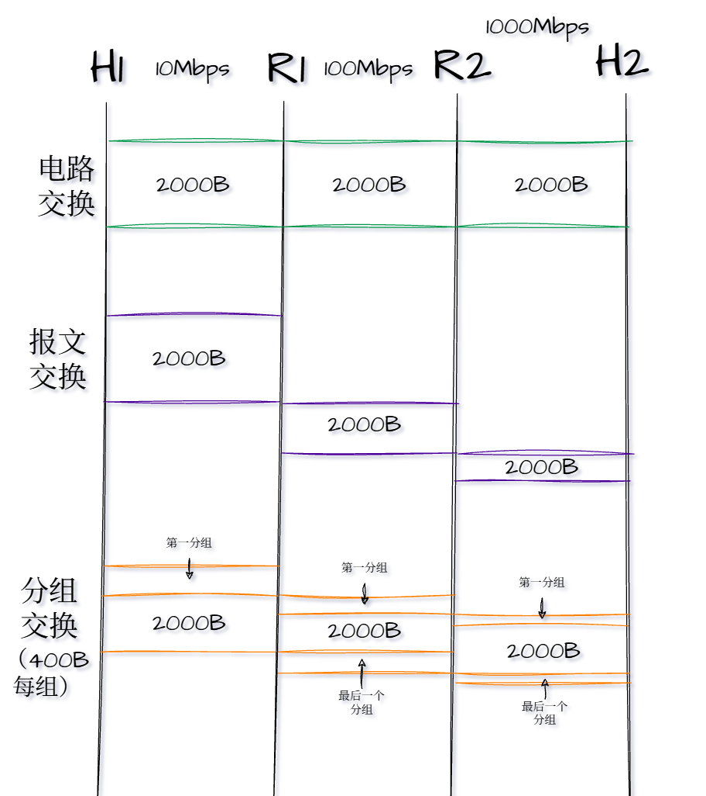

## DHCP全流程表格

| 报文         | 作用                                                 | 源 IP     | 目的 IP                             | 源 MAC     | 目的 MAC               |
| ------------ | ---------------------------------------------------- | --------- | ----------------------------------- | ---------- | ---------------------- |
| DHCPDISCOVER | 客户端找 DHCP 服务器                                 | 0.0.0.0   | 255.255.255.255                     | 客户端 MAC | FF:FF:FF:FF:FF:FF      |
| DHCPOFFER    | 服务器给出分配方案                                   | 服务器 IP | **准备分配给客户端的 IP（yiaddr）** | 服务器 MAC | **客户端 MAC（单播）** |
| DHCPREQUEST  | 客户端广播宣告：选定某一台服务器，其余服务器回收地址 | 0.0.0.0   | 255.255.255.255                     | 客户端 MAC | FF:FF:FF:FF:FF:FF      |
| DHCPACK      | 服务器确认分配生效                                   | 服务器 IP | **准备分配给客户端的 IP（yiaddr）** | 服务器 MAC | **客户端 MAC（单播**   |

## 408常考的网络协议汇总

> 说明：**ARP、ICMP、IP 属于网络层，没有端口号**；端口是运输层（TCP/UDP）的概念，408 选择题最爱在这里挖坑

| 协议   | 依赖传输层             | 熟知端口号（考研重点）                 | 核心作用（408 背诵版）                                |
| ------ | ---------------------- | -------------------------------------- | ----------------------------------------------------- |
| HTTP   | TCP                    | 80                                     | 超文本传输协议，明文网页传输，无状态                  |
| HTTPS  | TCP                    | 443                                    | HTTP+TLS 加密，安全网页访问                           |
| FTP    | TCP                    | 21（控制连接）、20（主动模式数据连接） | 文件传输；控制连接全程保持，数据连接按需建立          |
| TFTP   | UDP                    | 69                                     | 简单文件传输，轻量、无可靠机制                        |
| DNS    | UDP（优先）/TCP        | 53                                     | 域名↔IP 地址解析；查询用 UDP，长报文 / 区域传送用 TCP |
| DHCP   | UDP                    | 67（服务器）、68（客户端）             | 动态分配 IP、子网掩码、网关、DNS 等配置               |
| SMTP   | TCP                    | 25                                     | 邮件发送、服务器之间转发邮件                          |
| POP3   | TCP                    | 110                                    | 邮件接收，一般下载到本地后服务器删除邮件              |
| IMAP   | TCP                    | 143                                    | 邮件接收，邮件保留在服务器，多端同步                  |
| Telnet | TCP                    | 23                                     | 远程终端登录，明文传输（不安全）                      |
| SSH    | TCP                    | 22                                     | 加密远程登录，替代 Telnet                             |
| SNMP   | UDP                    | 161                                    | 简单网络管理协议，网管设备采集信息                    |
| RIP    | UDP                    | 520                                    | 内部网关路由协议，距离向量算法                        |
| ARP    | —（网络层）            | 无端口                                 | IP 地址 → 本机局域网 MAC 地址解析                     |
| ICMP   | —（网络层，封装在 IP） | 无端口                                 | 差错报告、网络探测；ping、traceroute 基于 ICMP        |
| IP     | —（网络层）            | 无端口                                 | 分组寻址、转发、分片                                  |
| TCP    | —（运输层）            | 无固定熟知端口                         | 面向连接、可靠、字节流，流量 + 拥塞控制               |
| UDP    | —（运输层）            | 无固定熟知端口                         | 无连接、不可靠、面向报文，开销小                      |
| OSPF   | 直接封装 IP            | 无端口                                 | 内部网关协议，链路状态路由                            |
| BGP    | TCP                    | 179                                    | 自治系统 AS 之间的外部网关路由协议                    |