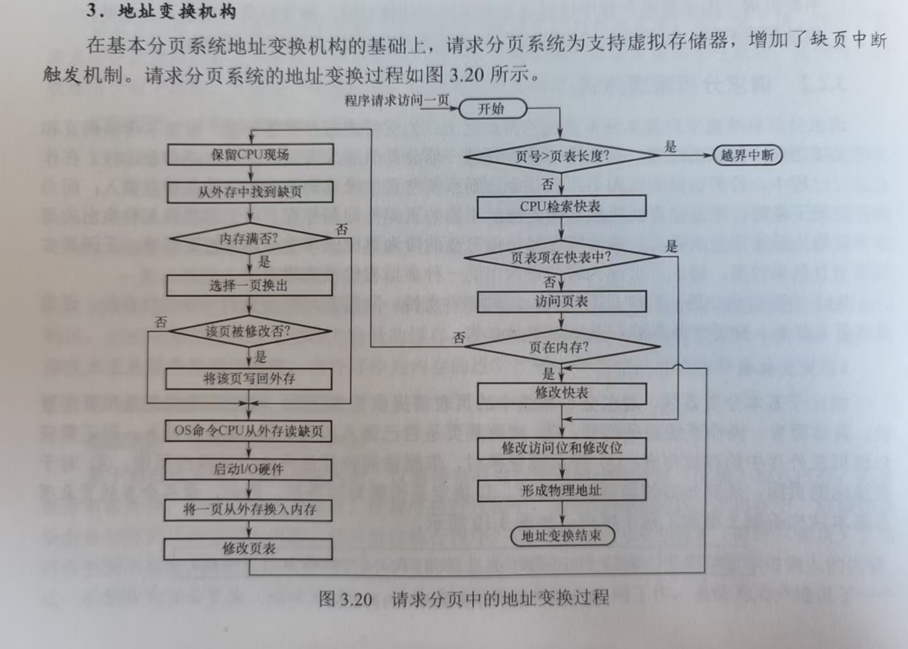
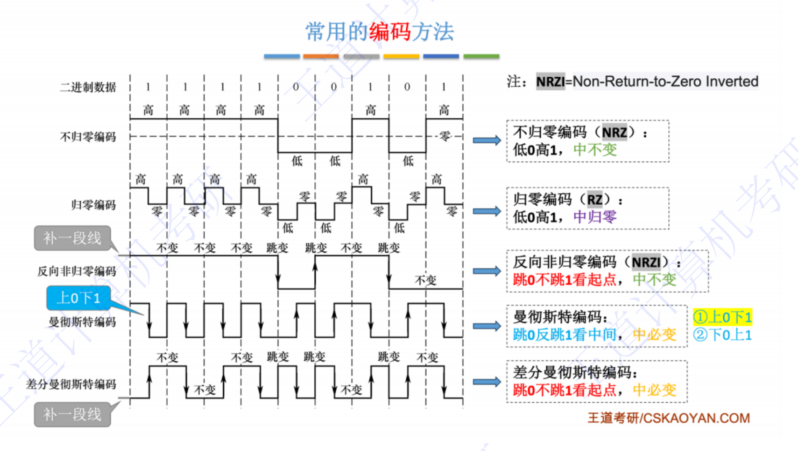
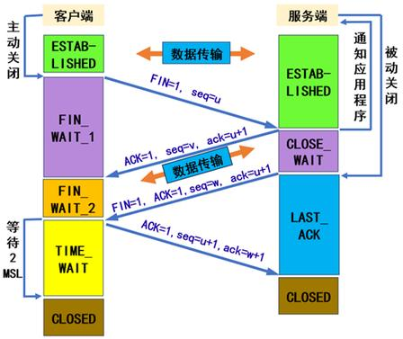
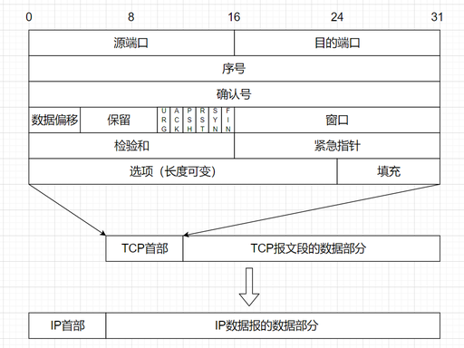
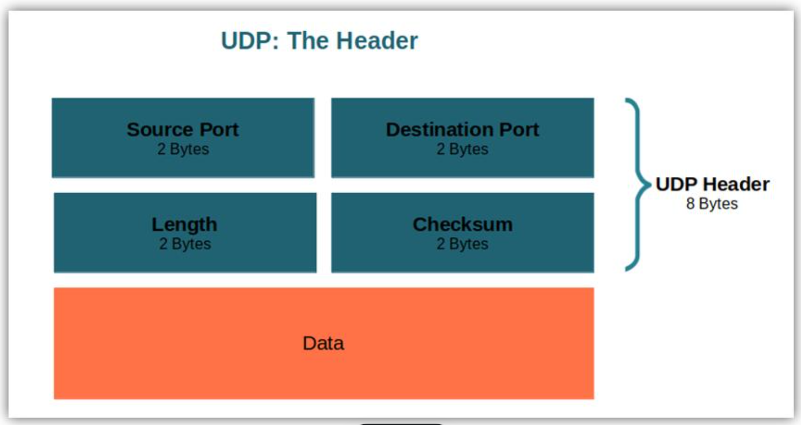
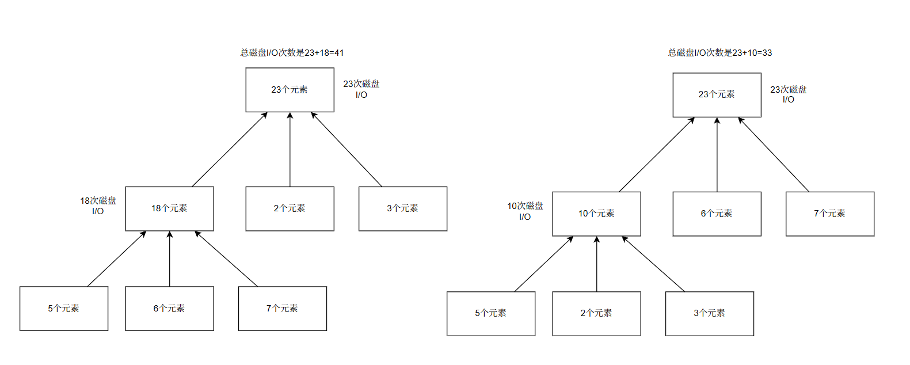
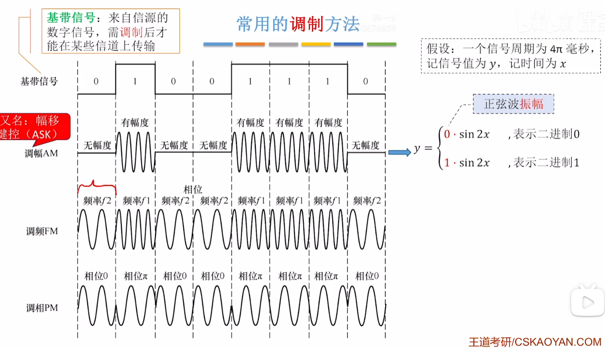
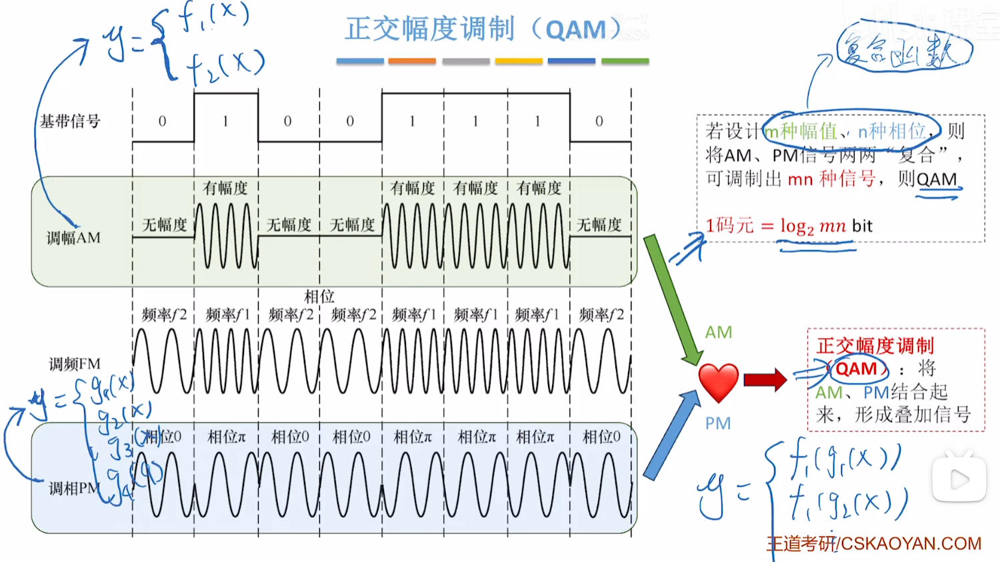
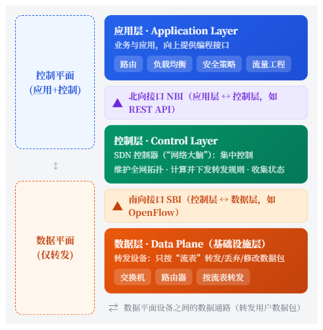

## 硬布线&微程序控制

硬布线

优点：因为它是组合逻辑电路，硬件直接响应，因此它的速度快。
缺点：难以扩展，当指令非常多时硬件电路会非常庞大；不好修改，每次修改后都需要重新设计硬件电路逻辑，修改成本太高。

微程序控制

优点：灵活性高，可维护性强。
缺点：每条微指令需要从控制存储器中去读取，导致微指令的执行需要的微周期数增加，从而影响执行速度。


微程序控制执行过程

1、将指令中的OP部分提取出来，交给微程序控制器中。
2、由微地址形成部件生成微指令的地址交给uPC。
3、由uPC告知控制存储器要取的微指令的地址在哪，取哪条微指令，并将微指令交给uIR。
4、uIR通过读取微指令中微命令部分的内容执行操作，再将微指令中下地址部分的内容交给微地址形成部件。

## 多总线结构

双总线结构 = 存储器总线（主存总线）+I/0总线

三总线结构 = 存储器总线 + I/0总线 + DMA总线

## 操作系统的进程调度

进程调度算法：FCFS（先进先出）算法、SJF（短作业优先）算法、高响应比优先算法、优先级调度算法、时间片轮转调度算法、多级队列调度算法、多级反馈队列调度算法

## 操作系统连续内存空间分配

连续内存分配算法：优先分配、邻近分配、最佳适应、最坏适应、基于索引的分配算法

## 三种网络参考模型

408 计算机网络中常考三种：**OSI 七层模型、TCP/IP 四层模型、五层参考模型（折中模型）**

## 最佳归并树（k 路归并）虚段计算公式

> m：**初始归并段数量**；k：归并路数
> 公式：
> 
> 
> $u=(m-1)\bmod(k-1)$
> 
> 
> 1. 如果 $\boldsymbol{u=0}$：**不需要虚段**，直接构造严格 k 叉哈夫曼树（最佳归并树）
> 2. 如果 $\boldsymbol{u\neq0}$：需要补充 $\boldsymbol{(k-1)-u}$ 个**虚段**（虚段权值 = 0）

> 
> 原理一句话：**最佳归并树必须是严格 k 叉树（每个分支结点都恰好有 k 个孩子）**。严格 k 叉树的叶子结点数量 $n_0$ 必须满足 $(n_0-1)\%(k-1)=0$。初始归并段就是叶子；不够就补权 = 0 的虚叶子（虚段）。

### 推导简单看（理解用，考试直接套公式）

严格 k 叉树的性质：

$n_0 = (k-1)n_k + 1$

$n_0$：叶子总数（真实段 + 虚段）；$n_k$：分支结点数目。

变形得到：$(n_0-1)$ 一定能被 $(k-1)$ 整除。

我们已有 m 个真实叶子。若 $(m-1)$ 除以 $(k-1)$ 有余数，就要补虚段，把总叶子数凑成满足这个整除条件的最小数。

## 地址变换机构（包含缺页中断处理）

> 见书《27操作系统》P214



## 时钟脉冲知识点回顾

* 晶振脉冲经整形、分频，生成 CPU 时钟脉冲。
* 时钟脉冲宽度即时钟周期；主频 = 1 / 时钟周期。
* 时钟周期由流水线组合逻辑最大延迟决定。

> 哪里不懂，具体问AI吧

## 线程概念考点的回顾

**进程**的诞生是为了解决多任务并发执行的问题，而**线程**的诞生是为了进一步降低并发执行的**开销**。

**线程**分为 **用户组线程** 与 **内核级线程** ：

* 用户级线程由用户空间的线程库进行创建与管理
* 内核级线程由内核空间的操作系统进行创建与管理

同一进程中的多个线程是共享进程资源的，但是线程的阻塞可能会导致其它线程也被阻塞，整个进程被挂起，为解决这个问题引入了**多线程模型**

* N对一模型，多个用户级线程对应一个内核级线程
  - 优点：线程切换在用户空间完成，开销小。
  - 缺点：线程阻塞会使用其它所有线程一起阻塞。
* 一对一模型：每个用户级线程都对应一个内核级线程
  - 优点：一个线程阻塞不会影响其它线程的执行，提升线程之间的并发性
  - 缺点：线程切换是在内核空间完成的，变成了内核级线程的切换，开销大
* N对M模型，N>=M,多个用户级线程对应一个内核级线程
  - 优点：是上面两种模型优点的折中型。

## 动态分区算法的回顾 

| 算法         | 空闲链表排序 | 核心思路           | 碎片                 | 大作业支持 | 查找开销       |
| ------------ | ------------ | ------------------ | -------------------- | ---------- | -------------- |
| 首次适应     | 地址递增     | 从头找第一个够大   | 较多（低地址小碎片） | 较好       | 一般           |
| 循环首次适应 | 地址递增     | 上次位置往后循环找 | 较多                 | 差         | 较小           |
| 最佳适应     | 容量升序     | 最小够用块         | **最多**             | 好         | 大（维护有序） |
| 最坏适应     | 容量降序     | 最大空闲块分配     | 较少                 | **最差**   | 大（维护有序） |

## B树的建造方法回顾

建造一个m阶的B树。

1. 将关键字按大小放在对应的结点中
2. 若结点中关键的数量超过了m-1，则将$\lfloor m/2 \rfloor$位置上的关键字提取出来，将其移至父结点中。
3. 当父结点中因2)移入新结点时，同样可能会发生2)的情况，直到B树稳定。

> K阶B树，最多有$m$棵子树，$m-1$个关键字，最少得有$\lceil m/2 \rceil$棵子树，$\lceil m/2 \rceil - 1$个关键字
> 
> 可供参考的视频，请看[【这里】](https://www.douyin.com/video/7552005514852388147)

## B树的删除

> 话不多说，上[视频](https://www.bilibili.com/video/BV1JU411d7iY)
>
> 一个精练的视频胜千言

## B树的基本概念

假设现有m阶B树

* B树除根节点可以至少有1个关键字外，其余非叶节点应至少有$\lceil m/2 \rceil$个子树和$\lceil m/2 \rceil -1$个关键字。

## B树与B+树的区别

在B树中分支结点会存储记录，但是在B+树中分支结点就不会存放数据，只有叶子结点才会存储数据，并且除第一叶子结点外，每个叶子结点的首结点都会有其父结点或者祖先结点对应。

> 具体过程，可以看[视频](https://www.iesdouyin.com/share/video/7690114146435665202/?region=CN&mid=7690114143122197299&u_code=0&video_share_track_ver=&titleType=title&share_sign=v8GvBl_YC29zKfK.MImM5oDdlD8xHiYFeWybtcf4lao-&share_version=15020040&ts=1791532557&from_aid=482431&from_ssr=1&share_track_info=%7B%22link_description_type%22%3A%22%22%7D)
>
> [视频2](https://www.iesdouyin.com/share/video/7668477862761100273/?region=CN&mid=7668477887921867546&u_code=0&video_share_track_ver=&titleType=title&share_sign=xwsfdCQDRyOY.kskQjmpR7c7_JGqCBogJi3sNilBxhQ-&share_version=15020040&ts=1791532557&from_aid=482431&from_ssr=1&share_track_info=%7B%22link_description_type%22%3A%22%22%7D)

## 处理器类型及相关问题

单周期CPU：
* CPI为1
* 时钟周期由执行时间最长的那条指令来决定
* 时钟频率低

多周期CPU：
* CPI一般都大于1
* 指令被拆分成多个阶段，每个阶段一个周期
* 时钟频率会高一点
* 时钟周期由各个阶段中执行时间最长的时间来决定
* 依旧是串行执行指令，没有并行

基本流水线CPU：
* 理想无阻塞的情况下，CPI为1
* 可并行执行指令
* 会有**冒险**问题

超标量流水线CPU：
* 比流水线不同的是，每个阶段可以有多个相同的部件并行执行，以加快指令的执行速度

## 中断处理与中断响应优先级的概念

当中断来临，首先会由中断屏蔽字来觉得响应哪个中断，通过中断屏蔽字的筛选后，再由中断判优机构来决定处理哪个中断。（我的回忆，这是错误的）

正确版：
### 1. 中断判优机构（硬件判优：中断排队电路）

**发生时机：多个中断源同时发中断请求 IR 的时候**
作用：**选出优先级最高的那个中断请求**，把它送到 CPU 的中断请求输入端。

- 硬件判优：链式排队电路、独立请求总线判优。
- 判优只做一件事：**多个中断同时到来，谁优先级高，谁获得请求信号**。

> 
> 判优，是**选择哪个中断请求被提交给 CPU**。

### 2. 中断屏蔽字（中断屏蔽寄存器 IMR）

**发生时机：CPU 准备响应中断的时候（或者中断服务程序内部）**
中断屏蔽字每一位对应一个中断源：

- 屏蔽位 = 1：屏蔽，这个中断就算来了，也不能打断当前执行；
- 屏蔽位 = 0：开放，可以响应。

核心：**屏蔽字决定：当前 CPU 环境下，能不能响应这个中断**。
屏蔽字可以动态修改！这就是**动态改变中断优先级**的原理。

> 
> 屏蔽字不是用来 “挑选多个中断里谁最高”，而是**控制是否允许该中断打断现场**。

> 我的总结就是：中断->中断判优->中断屏蔽字。
>
> 中断判优，决定中断请求信号归谁。在**同一时刻有多个中断源同时发请求**的时候，从这一堆请求里，**选出硬件静态优先级最高的那一个中断源**，产生一个**送到 CPU 的公共中断请求信号 INTR**。
>
> 中断屏蔽字，决定当前CPU处理哪个中断

## DMA 与 CPU 访存冲突的 3 种方案

1. 停止CPU访问内存
2. 周期挪用/周期窃取
3. DMA与CPU交替访存（时间分片、分时访问）

> 具体内容，自己人脑回忆，不再展开，可以问AI
>
> 错题，见2020年真题，题22

## 内存分配分类

```
存储管理
├─ 连续分配方式
│  ├─ 单一连续分配
│  ├─ 固定分区分配（静态分区）
│  └─ **动态分区分配（可变分区分配）**
└─ 非连续分配：分页、分段、段页式
```

> 例题，2020真题，题24
>
> 此题让我意识到，我自己现在对知识的体系框架已经有点乱了

## 乘法运算的实现

> 核心本质：乘法 = 加法 + 移位

无符号乘法（原码一位乘法，仅绝对值运算）
✅适用：无符号数、原码数值位相乘；符号位单独异或
寄存器：A (部分积，初 0)、B (被乘数)、Q (乘数)，A+Q 存 2n 位结果
循环 n 次（n = 数值位位数）

1. 看 Q 最低位\(Q_0\)
   - \(Q_0=1\)：A = A + B
   - \(Q_0=0\)：A 不变
2. A、Q 联合【逻辑右移】
结束：A 存乘积高 n 位，Q 存乘积低 n 位
考点短句：逻辑右移；只看 1 位；无符号；循环 n 次；符号单独处理

有符号乘法（Booth 补码乘法，大题重点）
✅适用：补码有符号数，符号位直接参与运算，无需单独求符号
寄存器：A (部分积，初 0)、Q (乘数)；乘数增设附加位\(Y_{n+1}\)，初始为 0
循环 n 次

1. 判断 Q 末位\(Y_n\)和附加位\(Y_{n+1}\)（两位）
   - 00、11：不加
   - 01：A += \([X]_{补}\)
   - 10：A += \([-X]_{补}\)
2. A、Q、附加位一起【算术右移】
考点短句：算术右移；看末尾两位 + 附加位；有符号补码；循环 n 次

阵列乘法器（选择题｜并行乘法）

- 无符号并行乘法，组合逻辑电路，无循环移位，速度最快，硬件开销大
- n 位 ×n 位 → 输出 2n 位乘积

## 关于树的路径长度

1. **WPL**：$Σ(叶子权 × 叶子到根的路径长度)$，构造哈夫曼树后求和
2. **路径长度**：用于配合 WPL 定义和哈夫曼编码（如 "等长 vs 变长编码总长度"）。根到第K层的结点，它的路径长度就是K-1
3. **ASL 与路径长度的关系**：二叉排序树查找成功 ASL = 各结点路径长度之和 /n（等价于平均比较次数），这是查找章节的高频考点

> 错题，2021真题，题5

## AVL树的插入与删除

> 该复习了，具体知识点内容太多，我就不在这儿详细展开，具体内容直接问AI吧

## 堆的插入与删除操作

* **堆的插入**：在堆的末尾插入，逐层进行向上调整的操作；
* **堆的删除**：将堆顶删除，将堆的末尾放入堆顶，逐层向下进行操作；

## 存储器对程序员可见性的分类

对程序员可见：基址寄存器、变址寄存器和标志/状态寄存器、通用寄存器、程序计数器PC

对程序员不可见：MAR、MDR、IR、微指令寄存器

## 总线事务与定时

这是《组成原理》第六章总线部分的概念，有时间一定要重新看视频回顾一下。

## 进程的五态模型

> 直接看这笔记，[详细](/personal-website/notes/the-five-state-model-of-os-processes/)


## 物理层的编码方式（忘记了看看）



## 四次挥手的不同阶段



## TCP和UDP首部内容与长度

TCP首部是20B~60B

UDP首部固定是8B





## 外部排序流程

1. 读入外存数据生成初始归并段，使用置换-选择算法来优化初始归并段的生成；
2. 进行K路归并，将K路归并段合并成一个新的更加长的归并段，直到只剩下唯一的归并段。使用败者树来优化这个归并过程；
3. 通过哈弗曼树来优化归并树，从而减少磁盘I/O次数，优化后的归并树叫作最佳归并树



## 指令集体系结构（ISA） 规定的内容

1. **指令格式**：操作码 OP、地址码字段，指令长度、定长 / 变长指令
2. **指令集**：可以执行的指令种类（算术、逻辑、访存、转移、IO 等）
3. **寻址方式**：有效地址怎么计算（立即、直接、间接、基址、变址、相对寻址等）
4. **寄存器定义**：程序员可见寄存器（通用寄存器、PC、PSW / 状态寄存器），寄存器位数
5. **数据类型**：硬件直接支持的数据类型（字节、半字、字、双字、浮点数等）
6. **存储器编址**：地址空间大小、编址单位（按字节编址 / 按字编址）、地址含义
7. **中断与异常机制**：异常类型、中断向量、程序状态、中断返回相关定义
8. **I/O 模型**：是存储器映射 I/O，还是独立 I/O 指令（IN/OUT）

## ❌ ISA**不规定**（选择题高频坑点）

- 流水线结构、Cache 大小、总线时序、ALU 实现、微指令、寄存器堆硬件电路

> 这些属于**微体系结构（微架构）**，同一 ISA 可以有不同硬件实现（例如 x86 ISA，Intel 和 AMD 不同 CPU）

## 驱动程序的作用

① 将上层 I/O 请求转换为设备控制器可识别的命令；

② 读写控制器寄存器，控制设备完成 I/O 操作；

③ 响应设备中断，处理 I/O 完成后的善后工作；

④ 检查请求合法性与设备状态，管理 I/O 请求队列；

⑤ 进行必要的数据格式转换，屏蔽底层硬件控制器差异，为上层提供统一访问接口。

> 2022年真题，题32

## 最大数据传输率与码元调制技术之间的关系

$log_{2}(码元的表示状态数)=每个码元携带的比特数$

调制技术有3种：





无噪声下，$最大数据传输速率=2W$（码元为单位），$最大数据传输速率=2W*log(码元状态数量)$（比特为单位）

有噪声下，$C = W \log_2\left(1 + \frac{S}{N}\right)
$

信噪比分贝值与功率比之间的换算公式：

$$
\mathrm{SNR_{dB}} = 10 \log_{10}\left(\frac{S}{N}\right)
$$

## SDN网络体系结构



## DHCP四次报文的名称是什么

| 顺序 | 报文             | 方向          | 作用               |
| ---- | ---------------- | ------------- | ------------------ |
| 1    | Discover（发现） | 客户端 → 广播 | 寻找 DHCP 服务器   |
| 2    | Offer（提供）    | 服务器 → 单播 | 提供 IP 地址等配置 |
| 3    | Request（请求）  | 客户端 → 广播 | 确认选用该地址     |
| 4    | ACK（确认）      | 服务器 → 广播 | 确认分配并给出租期 |

