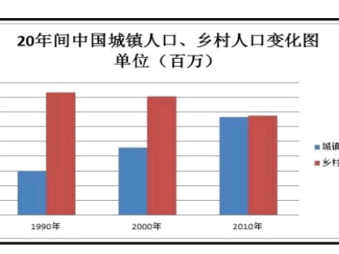
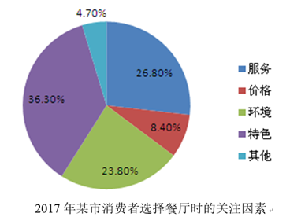

## 段落结构--图表作文

> 坑⚠️：采用什么图表📊形式不重要，关键是看数据📈有无变化，有变化则为动态图，无变化则为静态图。例如，柱状图既可以表示动态图也可以是静态图。

P1：描述图表

（图表下方文字概括+趋势（动）/占比（静）描述）

P2：分析原图

分析角度：政府/政策，经济，科技，媒体，社会，文化，学校，家庭，个人。

论证方法：因果论证/正反论证/举例论证/数据引用/名人名言引用。

P3：总结
（得出结论+趋势预测（动）/提出建议（静）

## 静态图

**P1**: The pie chart above clearly shows _____. It can be seen that \_\_\_A1\_\_\_ accounts for the largest part, with the portion of ___%, followed by \_\_\_A2&A3\_\_\_ which takes up \_\_\_%\_&\_%\_\_\_ respectively. On the contrary, \_\_\_A4\_\_\_ only occupies \_\_\_%.

**P2**: What are the reasons for the phenomenon?//

What the statistics reflect is closely related to the following factors.

To begin with,...

In addition,...

Furthermore,...

**P3**: From the analysis above, it can be concluded that... And, ... are supposed to...
Only by doing... can we...

## 动态图

**P1**: The bar/line chart above clearly shows (the change of) \_\_\_\_\_\_. It can be seen that the number of \_\_\_A\_\_\_ increased dramatically from \_\_\_ to \_\_\_, while that of \_\_\_ B \_\_\_ decreased significantly from \_\_\_ to \_\_\_. Meanwhile/On the contrary, there was a/an (obvious) decline/growth in that of \_\_\_C\_\_\_.

**P2**: What are the reasons for the phenomenon? //

What the statistics reflect is closely related to the following factors.

To begin with,...

In addition,...

Furthermore,...

**P3**: From the analysis above, it can be concluded that the current trend (of.. )will continue to \_\_\_rise/decline\_\_\_ in years to come.(And...are expected to...)