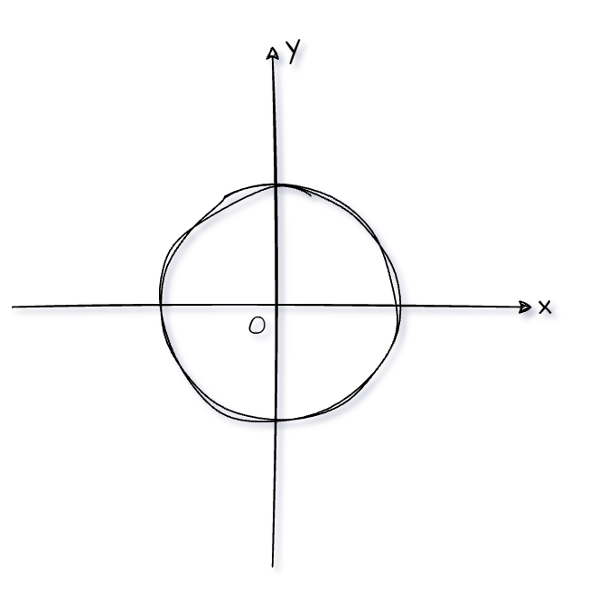
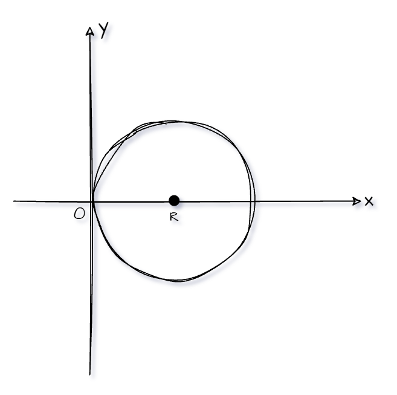
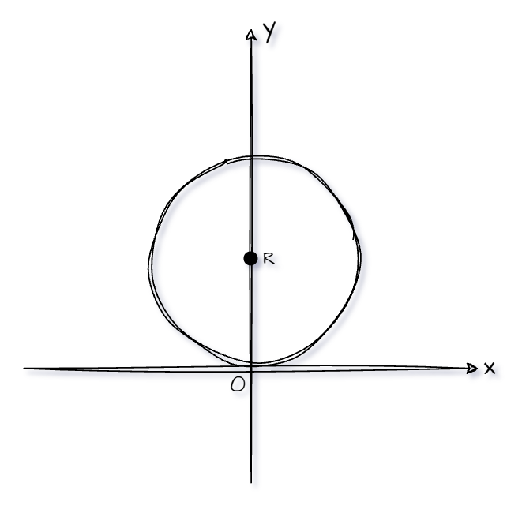
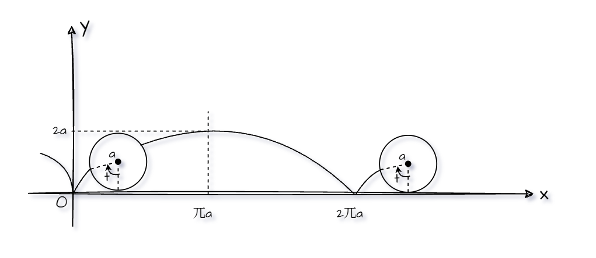
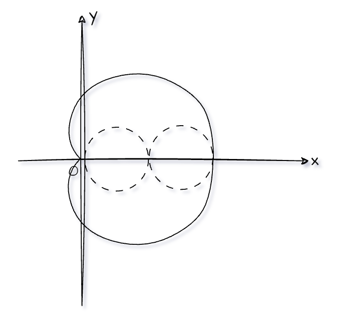
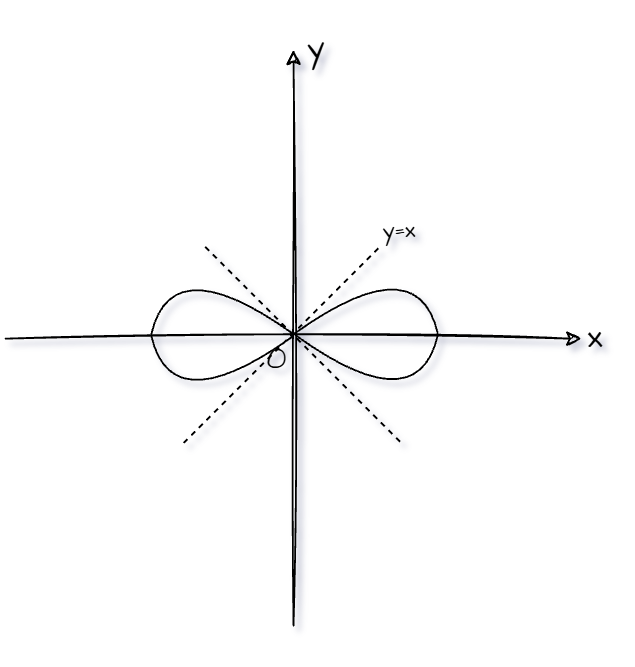
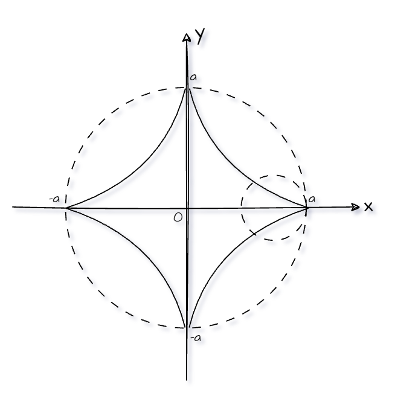

## 圆

$$
直角坐标形式：x^2+y^2=R^2
$$

$$
极坐标或参数形式：r=R
$$

$$
直角坐标形式：x^2+y^2=2Rx
$$

$$
极坐标或参数形式：r=2R\cos\theta
$$

$$
直角坐标形式：x^2+y^2=2Ry
$$

$$
极坐标或参数形式：r=2R\sin\theta
$$

$$
直角坐标形式：无
$$

$$
极坐标或参数形式：
\begin{cases}
x = a(t-\sin t), \\
y = a(1-\cos t)
\end{cases}
$$

$$
直角坐标形式：无
$$

$$
极坐标或参数形式：r=a(1+\cos\theta)
$$

$$
直角坐标形式：(x^2+y^2)^2=a^2(x^2-y^2)
$$

$$
极坐标或参数形式：r^2=a^2\cos2\theta
$$

$$
直角坐标形式：(x^{\frac{2}{3}}+y^\frac{2}{3})^2=a^{\frac{2}{3}}
$$

$$
极坐标或参数形式：
\begin{cases}
x = a\cos^3 t, \\
y = a\sin^3 t
\end{cases}
$$